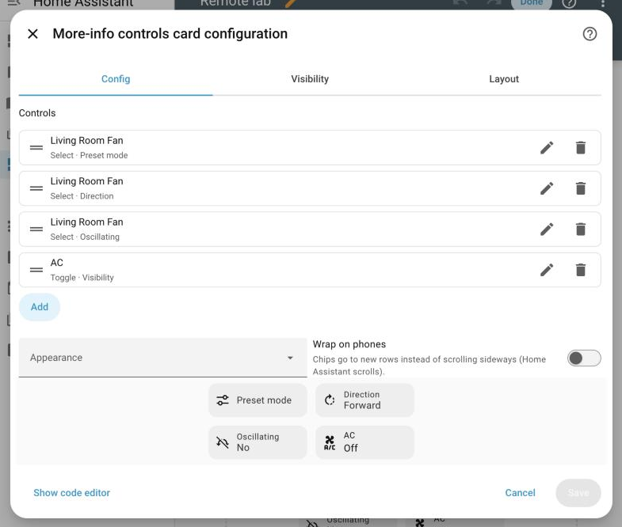
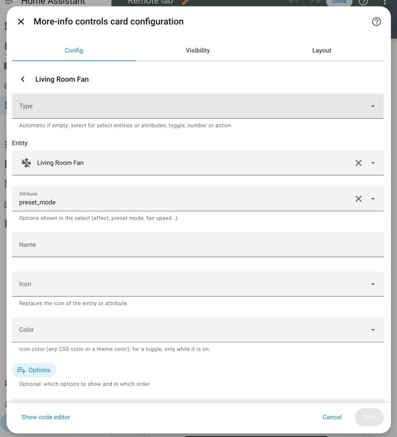

# Visual editor

[← Documentation index](README.md)

Popups are edited in Home Assistant's own card editor, with the same tools you
use for a dashboard section. Nothing needs YAML, except renaming select options.

## In the dashboard

In edit mode every popup shows as a placeholder with its id, its number of
cards and an eye icon (it is invisible when you leave edit mode). A section that
only holds popups disappears completely outside edit mode.

## Popup options

Click a placeholder to open the editor. The popup options are grouped like the
tile card editor: **General** (id, entity, title, icon), **Appearance** and
**Behavior**. The preview on the right shows the popup surface itself.

## Cards of the popup

Below the options, the popup's cards are a real sections grid in edit mode:

- drag a card to reorder it;
- click a card to edit it (inline, with a ← back arrow);
- **+** adds a card with the native card picker;
- **Test popup** opens the real popup with the unsaved configuration.

The ⋮ menu of each card has the native entries. **Copy** and **Cut** use the same
clipboard as the dashboard, so cards can move between the dashboard and any popup.
**Delete** shows an undo notice inside the editor.

After **Copy**, the card picker offers **Paste from clipboard** first:

### Header, main and footer

With **Layout → Header, main and footer** (`layout: zones`), the cards area
becomes a frame with the three zones. Each zone shows its own vertical and
horizontal alignment (and minimum height for the header and footer) next to
its grid, its own **+**, and cards can be dragged from one zone to another.

## Editing a card inside the popup

Every child card gets the native **Config / Visibility / Layout** tabs. The
Layout tab sizes the card on the popup grid (12 columns, or 24 with
`column_span: 2`). The toolbar has the code editor toggle, duplicate, copy, cut
and delete.

The controls card is edited as a native reorderable list. Each row says the
item's type, its attribute and whether it has visibility conditions:

An item opens in place, with a back arrow like the rows of the entities card
editor, and its form only has the fields its type uses: options and a custom
action for a select; minimum, maximum and step for a number; secondary text,
tap action and chevron for an action. The value field shows once a custom
action is set. Every item has the **Visibility** conditions (YAML):

The state card form also follows the config: icons for the toggle, trigger and
push controls; Cancel for scripts; the push button shape for `push`; the remote
options for media players (the remote picker on every media player, the rest
once there is a remote).

> Options with their own names or icons (`{value, name, icon}`) can only be
> edited in YAML; the form switches to the code editor for them.
